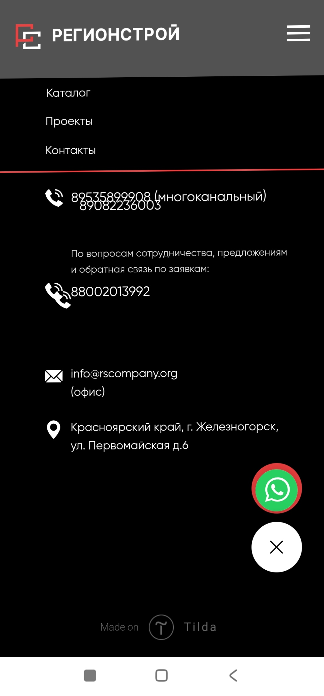

# Анализ пользовательского сценария

## Объект анализа

Сайт строительной компании «Регионстрой24» (Красноярский край).

Рассматриваемый процесс — обращение потенциального заказчика за строительными услугами через сайт: от знакомства с компанией до выбора способа связи.

## Выявленные проблемы

### 1. Контактная информация

В разных разделах сайта указаны разные телефонные номера без пояснения их назначения. Некоторые номера отображаются некорректно, что затрудняет звонок или копирование.

### 2. Содержание страниц

На странице услуги «Горизонтально направленное бурение» обнаружен текст, не относящийся к деятельности компании. Информация об услугах недостаточно конкретная, поэтому потенциальному заказчику может быть сложно оценить, подходит ли ему компания.

### 3. Актуальность информации

В представленных материалах о проектах указаны работы до 2021 года. Это может создавать впечатление, что информация на сайте давно не обновлялась.

### 4. Каналы обратной связи

На сайте представлено несколько форм обратной связи и указан WhatsApp, актуальность которого не подтверждена. Есть риск, что пользователь выберет неработающий способ обращения.

## Предложения по улучшению

- Привести телефонные номера к единому виду и обозначить назначение контактов.
- Исправить отображение номеров и ссылки для звонка.
- Проверить работу всех форм обратной связи и используемых мессенджеров.
- Предусмотреть понятное подтверждение отправки обращения и информацию об ожидаемом времени ответа.
- Обновить материалы о выполненных проектах и исправить некорректные тексты на страницах услуг.

## Ожидаемый результат

Пользователю станет проще найти подходящий способ связи, оставить обращение и понять, когда ожидать ответа. Изменения могут снизить вероятность потери потенциальных заявок.

Предложения носят рекомендательный характер, их внедрение и результативность в рамках учебного задания не проверялись.
